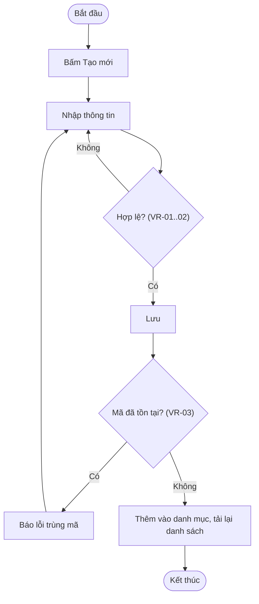

# Skill: Tài liệu chức năng trên Confluence EVN

Viết **tài liệu thiết kế mức nghiệp vụ** cho một chức năng và đăng thành trang Confluence trên
`https://docs.evn.com.vn`, đúng vị trí trong cây trang của space dự án (vd `PMIS3LUOI` → *04. Tài liệu thiết kế*).

## Bước 0 — Điều kiện tiên quyết (BẮT BUỘC, kiểm trước mọi việc khác)

Skill chỉ chạy được khi có MCP server Confluence EVN (`mcp-atlassian`) **đã kết nối** và **cho phép ghi**.
Tên server tùy máy (`confluence-evn` theo hướng dẫn, có máy đặt `evn-docs`…) — nhận diện theo tên tool, không theo tên server.

1. `ToolSearch` với từ khóa `confluence create page`:
   - Thấy `mcp__<server>__confluence_create_page` và `..._update_page` → đạt, sang Bước 1.
   - Chỉ có tool đọc (`confluence_get_page`, `confluence_search`…) → server đang `READ_ONLY_MODE=true`.
   - Không có tool `confluence_*` nào, hoặc báo server đang kết nối / kết nối thất bại → chưa kết nối.
2. Chưa đạt thì **DỪNG**, không soạn rồi bỏ đó. Báo người dùng đúng trường hợp và chỉ tới hướng dẫn
   **"Hướng dẫn kết nối Claude tới Confluence EVN qua MCP"**:
   https://docs.evn.com.vn/pages/viewpage.action?pageId=171477813

   | Trường hợp | Người dùng cần làm |
   |---|---|
   | Chưa cài server | Làm theo mục 2–3 của hướng dẫn (tạo PAT, `claude mcp add -s user ...`) với `READ_ONLY_MODE=false` |
   | Chỉ đọc | Đổi `READ_ONLY_MODE` thành `"false"` cho server đó trong `~/.claude.json` rồi khởi động lại Claude Code |
   | Timeout / không kết nối | Chạy `! uvx mcp-atlassian --help` để `uvx` tải gói, rồi `/mcp` → Reconnect |
   | 401 Unauthorized | PAT sai/hết hạn — tạo PAT mới (mục 2 của hướng dẫn) |

   **Không** tự đọc/sửa token trong `~/.claude.json`, **không** đề xuất ghi cấu hình có token vào `.mcp.json`
   (scope `project`) — token sẽ bị commit. Muốn biết server có đang chỉ đọc hay không: chỉ đọc khóa
   `READ_ONLY_MODE`, không in ra các biến khác.

## Bước 1 — Xác định đầu vào (hỏi nếu thiếu)

| Thông tin | Ví dụ | Ghi chú |
|---|---|---|
| **Trang cha** | URL `.../spaces/PMIS3LUOI/pages/139626081/...` hoặc ID | Bắt buộc. ID là số trong URL |
| **Vị trí / số mục** | `4.1.1` dưới nhóm `4.1. Hệ thống` | Nhóm trung gian chưa có thì tạo (Bước 3) |
| **Tên chức năng** | Quản lý danh mục đơn vị tính | Suy từ route/breadcrumb nếu thiếu |
| **Nguồn nghiệp vụ** | Thư mục code FE/BE, file `.md`, trang Confluence, mô tả trong chat | Có thể nhiều nguồn |

## Bước 2 — Thu thập nghiệp vụ từ nguồn

- **Mã nguồn FE** (Angular): component `*.ts` + `*.html` (cột bảng, trường form + validator, nút theo quyền),
  route (breadcrumb, guard), service (endpoint).
- **Mã nguồn BE** (Spring Boot): controller (endpoint), service (**quy tắc nghiệp vụ thật**: kiểm tra trùng,
  không cho sửa mã, phân quyền), DTO (ràng buộc), entity (tên bảng/cột). Đừng suy luật nghiệp vụ chỉ từ FE.
  Bố cục repo và cách lần FE→BE: xem skill `feature-doc` (mục "Map microservice → repo backend").
- **File `.md` / docs / trang Confluence**: đọc toàn bộ, lấy mục đích, đối tượng, luồng, quy tắc.
- Nguồn tham khảo là **hệ thống khác** (vd viết cho LUOI dựa trên NGUON): mô tả **đúng như nguồn đang làm**.
  Không tự thêm mục "điểm cần chốt", "đề xuất cải tiến", "khác biệt" trừ khi người dùng yêu cầu.

## Bước 3 — Kiểm tra cây trang

1. `confluence_get_page` trang cha → xác nhận đúng trang, đúng space.
2. `confluence_get_page_children` trang cha (và nhóm trung gian) → tránh trùng tiêu đề:
   - Đã có trang cùng chức năng → **cập nhật** trang đó (Bước 5), không tạo trang thứ hai. Hỏi nếu không chắc.
   - Nhóm trung gian (vd `4.1. Hệ thống`) chưa có → tạo trước, nội dung một câu giới thiệu + macro liệt kê trang con:
     ```xml
     <p>Tài liệu thiết kế các chức năng thuộc phân hệ <strong>Hệ thống</strong>.</p>
     <ac:structured-macro ac:name="children"><ac:parameter ac:name="all">true</ac:parameter></ac:structured-macro>
     ```
3. Đặt tiêu đề theo quy ước số mục của space: `4.1. Hệ thống`, `4.1.1. Quản lý danh mục đơn vị tính`
   (số, dấu chấm, khoảng trắng, tên — giống `3.1. Nghiệp vụ Quản lý sự cố`).

## Bước 4 — Chia chức năng thành chức năng con

Mỗi thao tác nghiệp vụ có luồng riêng là **một chức năng con**, đăng thành **trang con** của trang chức năng,
đánh số tiếp theo: `4.1.1.1. Xem danh sách, tìm kiếm`, `4.1.1.2. Thêm mới`, `4.1.1.3. Cập nhật`, `4.1.1.4. Xóa`.
Số mục là mã để theo dõi (ticket, kiểm thử, trao đổi) — giữ ổn định, thêm chức năng con mới thì đánh số tiếp,
không đánh lại số cũ.

- Tách thao tác phức tạp thành nhiều chức năng con (vd *Phê duyệt* tách *Gửi duyệt*, *Duyệt*, *Từ chối*;
  *Nhập từ Excel* tách riêng khỏi *Thêm mới*).
- Chức năng chỉ có một thao tác thì không tách, viết gọn trong một trang.
- Cập nhật tài liệu cũ chưa tách: giữ trang chức năng làm trang tổng quan, chuyển nội dung từng thao tác
  sang trang con.

## Bước 5 — Viết tài liệu: mức NGHIỆP VỤ, không phải mức code

Người đọc là BA/PO/kiểm thử. Tài liệu thiết kế **mô tả chức năng làm gì**, không mô tả code viết ra sao.

**Không đưa vào:** tên class/file/đường dẫn mã nguồn, annotation (`@NotBlank`…), kiểu cột CSDL chi tiết,
placeholder, số ms debounce, số dòng mỗi trang, hiệu ứng rê chuột, mã HTTP, tên role kỹ thuật
(`ROLE_SUPER_ADMIN` → "quản trị hệ thống"). Thông báo lỗi nghiệp vụ thì **có** ghi (trong bảng validator).

### 5.1. Trang chức năng (tổng quan)

```
1. Mô tả chung          — bảng: Chức năng, Phân hệ, Đối tượng sử dụng, Mục đích
2. Thông tin quản lý    — bảng: Thông tin | Bắt buộc | Mô tả (ví dụ giá trị) + một câu phạm vi
                          (dùng chung / theo đơn vị)
3. Danh sách chức năng con — bảng: Mã (số mục) | Chức năng con | Mô tả ngắn | Người thực hiện,
                          tiếp theo là macro children để liệt kê trang con
4. Sơ đồ tổng quan      — activity tổng (vào màn hình → chọn thao tác → chức năng con);
                          stateDiagram nếu đối tượng có trạng thái
5. Phân quyền           — bảng: Chức năng con | Ai được thực hiện
6. Dữ liệu              — bảng dữ liệu + cột chính, service
```

### 5.2. Trang chức năng con

```
1. Mô tả                — mục đích, người thực hiện, điều kiện trước (quyền, trạng thái), kết quả sau
2. Luồng xử lý          — activity diagram (Mermaid) + các bước chính dạng danh sách đánh số,
                          kèm luồng ngoại lệ (dữ liệu không hợp lệ, trùng, không có quyền…)
3. Sơ đồ tuần tự        — sequence diagram (Mermaid): Người dùng → Giao diện → Service → CSDL
4. Kiểm tra hợp lệ      — bảng validator (5.3)
5. API sử dụng          — bảng: Phương thức | Đường dẫn | Mô tả
```

Chức năng con chỉ đọc đơn giản (xem danh sách) được bỏ sequence diagram nếu nó không nói thêm gì.

### 5.3. Validator — xác định rõ từng quy tắc

Liệt kê **mọi** quy tắc kiểm tra dữ liệu, lấy từ cả FE (validator form) lẫn BE (DTO + service).
Một dòng cho một quy tắc, đánh mã để kiểm thử trích dẫn:

| Mã | Trường | Quy tắc | Kiểm tra tại | Thông báo khi vi phạm |
|---|---|---|---|---|
| VR-01 | Mã đơn vị tính | Bắt buộc | Giao diện, Máy chủ | Mã đơn vị tính không được để trống |
| VR-02 | Mã đơn vị tính | Tối đa 25 ký tự | Giao diện, Máy chủ | Mã đơn vị tính tối đa 25 ký tự |
| VR-03 | Mã đơn vị tính | Không trùng mã đã có | Máy chủ | Mã đơn vị tính đã tồn tại |

- Mã `VR-xx` đánh **theo từng trang chức năng con**, bắt đầu từ 01.
- *Kiểm tra tại*: `Giao diện`, `Máy chủ` hoặc cả hai — đúng như nguồn làm, không tự thêm.
- Ghi cả quy tắc không gắn với một trường (vd "Không được đổi mã khi cập nhật", "Không xóa khi đang được sử dụng").

### 5.4. Sơ đồ Mermaid

| Loại | Mermaid | Dùng cho |
|---|---|---|
| Activity | `flowchart TD` | Luồng xử lý, rẽ nhánh hợp lệ / không hợp lệ |
| Sequence | `sequenceDiagram` | Tương tác Người dùng / Giao diện / Service / CSDL |
| State | `stateDiagram-v2` | Đối tượng có trạng thái (nháp → chờ duyệt → đã duyệt…) |

- Nhãn tiếng Việt đặt trong ngoặc kép: `A["Nhập thông tin"]`, `B{"Hợp lệ?"}`; tránh `;`, `#` và ngoặc
  không bọc trong nhãn.
- Tham chiếu mã validator trên nhánh lỗi: `B -- "Không (VR-01..03)" --> E["Báo lỗi"]`.
- Sơ đồ mô tả nghiệp vụ, không vẽ tên class/hàm.

Ví dụ activity:



## Bước 6 — Đăng lên Confluence

- Dùng `content_format: "storage"` (XHTML storage), truyền nội dung qua **`content`**.
  **Không dùng `content_file`** với file ngoài thư mục làm việc (scratchpad, `%TEMP%`) — server từ chối
  ("Path traversal detected").
- Escape ký tự XML trong storage: `&` → `&amp;`, `<` → `&lt;` (trong văn bản và `<code>`).
- **Nhúng Mermaid.** Confluence EVN có preview Mermaid hay không tùy plugin được cài — tài liệu luôn mang
  mã nguồn Mermaid, có preview thì tốt, không có thì để dạng khối code:
  1. Tìm macro Mermaid đang được dùng trong Confluence: `confluence_search` với CQL
     `macro = "mermaid" OR macro = "mermaid-macro" OR macro = "mermaid-cloud"` (để `spaces_filter` rỗng).
     Có kết quả → đọc một trang đó ở dạng HTML (`convert_to_markdown: false`) để lấy đúng tên macro và
     tham số, rồi nhúng sơ đồ bằng macro đó (Confluence hiển thị sơ đồ).
  2. Không có kết quả → nhúng bằng macro `code` (luôn có sẵn), không hiển thị thành hình:
     ```xml
     <ac:structured-macro ac:name="code">
       <ac:parameter ac:name="title">Activity – Thêm mới (Mermaid)</ac:parameter>
       <ac:plain-text-body><![CDATA[flowchart TD
       S(["Bắt đầu"]) --> A["Bấm Tạo mới"]
     ]]></ac:plain-text-body>
     </ac:structured-macro>
     ```
     Mã trong `CDATA` không cần escape `&`, `<`. Báo người dùng rằng sơ đồ đang ở dạng mã nguồn vì
     Confluence chưa có plugin Mermaid.
  Không tự render ảnh hay đưa sơ đồ lên dịch vụ ngoài.
- Thứ tự tạo: trang nhóm trung gian → trang chức năng → các trang chức năng con (theo số mục).
- Trang mới: `confluence_create_page` với `space_key`, `parent_id`, `title`.
- Cập nhật trang có sẵn: đọc trang trước (`confluence_get_page`), giữ phần người khác đã viết nếu không
  được yêu cầu thay, rồi `confluence_update_page` kèm `version_comment` ngắn (vd "Rút gọn mức chi tiết").
- Đăng xong báo người dùng: tiêu đề + link từng trang đã tạo/sửa, và tóm tắt các mục của tài liệu.

## Lỗi hay gặp

| Hiện tượng | Xử lý |
|---|---|
| Không có tool `confluence_create_page` | Server chỉ đọc — Bước 0 |
| `Path traversal detected` khi dùng `content_file` | Truyền nội dung qua `content` |
| Trang hiển thị macro lỗi | Kiểm tra lại cú pháp `ac:structured-macro`, đóng thẻ đủ |
| Tạo trùng trang | Luôn `get_page_children` trước khi tạo (Bước 3) |
| Tài liệu bị chê "chi tiết quá" | Bỏ chi tiết mức code theo Bước 5; quy tắc dồn vào bảng validator |
| Sơ đồ Mermaid lỗi cú pháp khi preview | Bọc nhãn trong ngoặc kép, bỏ `;` `#` trong nhãn |
| Macro Mermaid hiện "Unknown macro" | Tên macro sai hoặc plugin đã gỡ — chuyển sang macro `code` |
